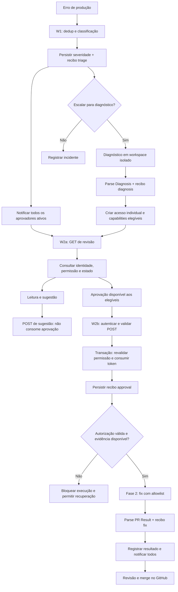

# Plano: múltiplos aprovadores + recibos BoundaryAttest (análise do ChatGPT)

> **Origem:** análise gerada pelo ChatGPT a partir do prompt de planejamento, lendo este repo
> (`f324daa…`) e o BoundaryAttest (`aa443e9…`). Transcrita sem alterações de conteúdo.
>
> **Conferência feita no código (Claude Code):** as afirmações sobre os workflows (severidade só no
> caminho `logged`, token dentro de `diagnosis_json`, Switch `<=5`/`>=5`, `If1` do W2b, `.incident`
> escrito antes do `flock`, `git add -A` no export, `catch` do `withServerReceipt`, path
> `test-force-error`) foram verificadas e estão corretas.
> **Correção importante:** na Fase 0 o plano diz que não confirmou telefones literais em
> `workflows/qfPih1jqBdVqoZ3v.json`. **Há telefones reais** no `staticData` (`rateLimits`, formato
> `55119…@s.whatsapp.net`) desse workflow ("PetShop WhatsApp AI Assistant"), re-exportado pelo W0
> todo dia e presente no histórico do repo público. Tratar como pré-requisito.

---

## 1. Arquitetura final

**Responsabilidade central:** n8n/Postgres decide quem pode agir; BoundaryAttest assina evidências
dessas decisões. A existência de um recibo, isoladamente, nunca libera a Fase 2.

O desenho preserva as correções e a validação do Cullen na
[issue #1](https://github.com/Vitin4267/n8n-self-healing/issues/1).

### Premissas que precisam de ajuste

| Premissa | O que foi encontrado |
|---|---|
| Severidade `ERROR/CRITICAL` | O `Structured Output Parser` usa `low`, `medium`, `high`, `critical`. Recomendação: **partial aprova exclusivamente `low`**; qualquer outro valor fica sem aprovação. |
| Severidade disponível no banco | W1 grava `severity` apenas no caminho não escalado. `Save Diagnosis & Generate Token` não a persiste. |
| Fail-open na triagem já garantido | Está descrito no README e no prompt, mas o JSON do `AI Agent` não configura uma saída de erro/fallback que garanta isso diante de falha do modelo/parser. |
| Token representa uma pessoa | Atualmente representa posse do link. Não existe vínculo autenticado com um aprovador. |
| Arquivo do incidente protegido pelo lock | W1 e W2b escrevem `.incident/current.json` **antes** de entrar no `flock`; duas execuções podem trocar o conteúdo usado pelo agente. |
| Allowlist garante todas as restrições | Ela restringe ferramentas, mas `Edit/Write` e `Bash(git:*)` não equivalem a isolamento por arquivo nem impedem, por si, todas as operações perigosas de Git. |

Fontes: [W1](../../workflows/w1-detection-triage.json), [W2b](../../workflows/w2b-approve-and-fix.json),
[README](../../README.md).

---

## 2. Schema e migração idempotente

Esta seção especifica tabelas, tipos, restrições e a sequência da migração; não traz um script SQL
executável.

### Tabela `approvers`

| Campo | Tipo proposto | Regra |
|---|---|---|
| `id` | UUID | Chave primária; identificador usado nas evidências. |
| `phone_e164` | TEXT | Obrigatório, normalizado e único. Somente no banco privado. |
| `name` | TEXT | Obrigatório; não precisa aparecer em recibos exportados. |
| `permission_level` | TEXT | CHECK: `full`, `partial`, `junior`. |
| `active` | BOOLEAN | Permite revogar acesso sem apagar histórico. |
| `auth_issuer`, `auth_subject` | TEXT | Vínculo com identidade autenticada; combinação única quando preenchida. |
| `authorization_version` | BIGINT | Incrementada em alterações de nível, identidade ou ativação. |
| `created_at`, `updated_at` | TIMESTAMPTZ | Controle administrativo. |

**Telefone é endereço de notificação, não autenticação.** Recomendação: login individual diante de
W2a/W2b, com identidade validada por um componente de autenticação. O backend usa o identificador
autenticado para encontrar `approvers.id`.

### Novas colunas em `incidents`

Manter o `id SERIAL` existente; não trocar a chave primária nesta integração.

| Campos | Finalidade |
|---|---|
| `policy_version TEXT` | Identifica a regra aplicada; associar a um manifesto versionado e seu hash. |
| `classification_json JSONB`, `classification_source TEXT` | Resultado normalizado e origem: modelo ou fallback. |
| `diagnosis_version INTEGER`, `diagnosis_hash TEXT` | Identificam exatamente o diagnóstico submetido à aprovação. |
| `workflow_snapshot_hash TEXT`, `source_commit TEXT` | Identificam os bytes analisados e a base de código. |
| `decision_id UUID`, `decision_action TEXT` | Decisão vencedora: aprovação ou rejeição. |
| `decided_by UUID`, `decided_at TIMESTAMPTZ` | Aprovador e instante da decisão; FK para `approvers`. |
| `approval_context JSONB` | Snapshot imutável da autorização que venceu a transação. |
| `approval_receipt_id UUID`, `approval_receipt_hash TEXT` | Evidência específica exigida antes da Fase 2. |
| `execution_attempt_id UUID`, `execution_started_at TIMESTAMPTZ` | Controle de tentativa de execução. |
| `execution_state TEXT` | `not_started`, `blocked_evidence`, `ready`, `running`, `completed`, `unknown`, `aborted`. |
| `receipt_health TEXT` | `pending`, `complete`, `degraded`; separado do resultado operacional. |

A coluna `severity` existente recebe restrição aos quatro valores reais. Incidentes legados sem
classificação confiável continuam sem capacidade de aprovação parcial.

Não colocar quatro recibos completos diretamente na linha de `incidents`: tentativas, falhas e
reemissões exigem histórico.

### Tabelas auxiliares necessárias

**`incident_access` — acesso individual por incidente**

- `id`, `incident_id`, `approver_id`, validade e revogação.
- Hash do segredo de acesso, caso links individualizados sejam usados.
- Escopo de leitura/sugestão.
- Não concede aprovação por si só.

**`incident_approval_tokens` — capabilities de decisão**

- `id`, `incident_id`, `approver_id`, `token_hash`.
- `diagnosis_version`, `policy_version`, validade, consumo e revogação.
- Emitir somente para quem é elegível naquele momento.
- Nunca armazenar o segredo em evidências; usar o UUID do token como `approvalTokenRef`.

**`incident_suggestions`**

- Incidente, aprovador autenticado, texto, data e diagnóstico relacionado.
- Sugestão não consome token, não altera diagnóstico aprovado e não inicia fix.
- Tratar conteúdo como entrada não confiável, inclusive para prompts.

**`incident_events` — eventos e fila persistente de emissão**

- `event_id`, incidente, estágio, tentativa, horário original.
- `input_evidence`, `output_evidence`, `tool_metadata`.
- Estado da emissão, tentativas e erro operacional sanitizado.
- Chave de idempotência única.
- A evidência do evento fica imutável depois de criada.

**`incident_receipts`**

- Evento, `receipt_id`, recibo JSON completo, hash do recibo e `public_key_id`.
- Um recibo aceito por evento.
- Sem permissão de sobrescrita para o usuário normal da aplicação.

**`incident_notifications`**

- Evento, aprovador, canal, entrega e tentativas.
- Uma falha de envio não impede notificar os demais.
- Permite demonstrar que todos entraram na fila, sem alegar que todos leram.

### Consumo atômico com vários aprovadores

Tokens individuais, sozinhos, não impedem dois aprovadores de iniciar dois fixes. É preciso também
uma **decisão vencedora única por incidente**.

A transação do W2b deverá:

1. Bloquear as linhas relevantes em ordem consistente, incluindo incidente e aprovador.
2. Ler do banco identidade vinculada, nível atual, severidade, política e versão do diagnóstico.
3. Validar a ação explicitamente.
4. Consumir o token com `UPDATE ... WHERE ... RETURNING`.
5. Reservar a decisão única do incidente.
6. Salvar o snapshot de autorização e o evento `approval`.
7. Invalidar as capabilities concorrentes daquele incidente.
8. Confirmar tudo junto.

Se qualquer condição falhar, **rollback da transação inteira**. Uma leitura de permissão em um nó e
um UPDATE desprotegido em outro deixaria uma janela de corrida.

### Sequência da migração idempotente

1. Criar uma migração versionada, com checksum e lock de migração.
2. Criar tabelas/colunas ausentes; conferir tipos e restrições de objetos já existentes.
3. Adicionar campos inicialmente opcionais para não quebrar os workflows antigos.
4. Validar/backfill de registros legados, sem inventar identidade, severidade ou aprovação histórica.
5. Invalidar links legados pendentes e emitir novos acessos após o corte.
6. Adicionar e validar CHECKs, FKs e índices únicos.
7. Retirar DDL do caminho normal do W1; o nó atual de criação passa a conferir versão do schema.
8. Executar a migração novamente: nenhuma duplicação, perda de dados ou mudança de resultado.

`IF NOT EXISTS` não basta: ele evita recriação, mas não detecta uma tabela existente com definição
errada.

---

## 3. Mudanças nó a nó

### W1 — Detection & Triage

Referência: [workflows/w1-detection-triage.json](../../workflows/w1-detection-triage.json).

| Nó existente | Mudança planejada |
|---|---|
| `Error Trigger` | Preservar; registrar também referência da execução para correlação. |
| `Code in JavaScript` | Preservar fingerprint; separar mensagem original, normalização e dados sanitizados de evidência. |
| `Execute a SQL query` | Substituir criação de tabela por verificação da versão de schema. |
| `Expire Old Incidents` | Expirar acessos/tokens pendentes. Não tratar execução já iniciada como simples link expirado. |
| `Check Dedup` | Incluir estados de aprovação pendente de recibo e execução em andamento. Preservar a janela atual de 60 minutos explicitamente, ou alterá-la em decisão separada. |
| `Edit Fields1`, `If` | Preservar encaminhamento e saída quando nenhum incidente existe. |
| `Execute a SQL query1` | Parametrizar atualização de ocorrências; hoje o ID é interpolado na query. |
| `Insert New Incident` | Registrar versão de política e estado inicial. Proteger criação concorrente para o mesmo fingerprint. |
| `Rate Limit Check`, `Switch` | Tornar saídas exclusivas; hoje os limites `<=5` e `>=5` se sobrepõem em 5. Conectar o caminho `spam` a persistência explícita. |
| `Prepare AI Input` | Preservar contexto, sem incluir segredos. |
| `AI Agent` | Configurar tratamento real de erro, timeout e resposta inválida. |
| `Structured Output Parser` | Manter `low/medium/high/critical`. |
| `If1` | Ler a classificação normalizada, não diretamente uma saída presumidamente válida do agente. |
| `Execute a SQL query2` | Persistir `logged` antes de depender de envio de mensagem. |
| `Send a message` | Integrar à fila de destinatários, se email continuar sendo usado. |
| `Call 'Sub - Export Workflows'` | Produzir snapshot identificável; impedir colisão com o workspace da Fase 2. |
| `Code in JavaScript1` | Preparar contexto por incidente/tentativa, com snapshot e hashes. |
| `Convert to File`, `Read/Write Files from Disk` | Escrever em diretório exclusivo; abandonar `.incident/current.json` global. |
| `Execute Command` | Diagnóstico em workspace isolado; manter `Read,Grep,Glob`. |
| `Parse Diagnosis` | Validar schema, caminhos, tipos e resultado; não aceitar apenas porque `JSON.parse` funcionou. |
| `Generate Token` | Gerar capabilities individuais elegíveis, separadas do objeto de diagnóstico. |
| `Save Diagnosis & Generate Token` | Salvar diagnóstico limpo, hash, versão, severidade e registros de acesso/capability. |
| `Send Text` | Enviar por destinatário, com acesso individual e capacidades calculadas. |

**Novos nós, nesta ordem lógica:**

- `Normalize Triage Result`: fallback determinístico para `high`, `escalate=true`, com origem `fallback`.
- `Persist Triage Event`: grava classificação em ambos os caminhos.
- `Emit Triage Receipt`: imediatamente após normalização/persistência do resultado do `AI Agent`.
- `Queue Incident Notifications`: inclui todos os aprovadores ativos, independentemente do nível.
- `Persist Diagnosis Event` e `Emit Diagnosis Receipt`: após `Parse Diagnosis`.
- `Load Approvers & Issue Access`: prepara acessos e capabilities.
- Tratamento de falha de recibo que preserva a notificação e marca pendência.

**Correção adicional importante:** hoje `Generate Token` acrescenta o token ao JSON e
`Save Diagnosis & Generate Token` serializa o objeto inteiro. Isso também coloca o segredo dentro de
`diagnosis_json`. Separar esses dados.

Há outro ponto fora do W1: o [sub-export-workflows.json](../../workflows/sub-export-workflows.json)
executa `git checkout main`, `git add -A`, commit e push. Ele precisa de checkout próprio e exportação
sanitizada, para não capturar arquivos de uma correção concorrente.

### W2a — Review Page

Referência: [workflows/w2a-review-page.json](../../workflows/w2a-review-page.json).

| Nó existente | Mudança planejada |
|---|---|
| `Webhook` | Manter GET estritamente de leitura; exigir identidade autenticada para revisão sensível. |
| `Execute a SQL query` | Buscar incidente/acesso vinculado ao usuário autenticado e calcular capacidades atuais. Não usar o token de aprovação como credencial universal de leitura. |
| `If` | Corrigir a expressão atual `=$json.id`, que não está no formato de expressão usado pelos outros nós; testar incidente encontrado/não encontrado. |
| `Code in JavaScript` | Escapar todo conteúdo inserido no HTML; renderizar botões conforme capacidade; exibir versão do diagnóstico. |
| `Respond to Webhook1` | Resposta sem detalhes desnecessários sobre existência do incidente. |
| `Respond to Webhook2` | Adicionar política de cache e referrer restritiva, além da proteção adequada contra scripts injetados. |

**Novos componentes:**

- `Resolve Authenticated Approver`.
- `Read Current Capabilities`.
- Formulário de sugestão com POST separado.
- Proteção CSRF para ações usando sessão de navegador.

O GET não consome, renova nem emite token. A capability deve existir antes, ou ser obtida por um POST
autenticado específico.

A página atual concatena mensagem de erro e diagnóstico diretamente no HTML. Isso cria uma superfície
de XSS: um erro controlado por atacante não pode virar JavaScript executado na sessão de um aprovador.

### W2b — Approve & Fix

Referência: [workflows/w2b-approve-and-fix.json](../../workflows/w2b-approve-and-fix.json).

| Nó existente | Mudança planejada |
|---|---|
| `Webhook` | Receber somente POST; validar formato, ação permitida, sessão, CSRF e limites. |
| `Execute a SQL query` | Substituir pelo consumo transacional descrito acima, incluindo autorização atual. |
| `If` | Distinguir autorização negada, token inválido, conflito e decisão aceita; preservar tratamento de zero linhas. |
| `Respond to Webhook` | Retornar erro HTTP coerente, sem vazar dados. |
| `Respond to Webhook1` | Confirmar que a decisão foi registrada, sem afirmar que o fix começou. |
| `If1` | Usar ação validada e persistida. Hoje qualquer ação diferente de `approve` segue para rejeição depois de consumir o token. |
| `Prepare Fix Incident File` | Usar snapshot aprovado, versão/hash do diagnóstico e `approvalReceiptId/Hash`. |
| `Convert to File`, `Read/Write Files from Disk` | Contexto exclusivo por tentativa. |
| `Execute Command` | Executar somente após reserva atômica da tentativa; workspace isolado, base conferida e allowlist preservada. Evitar reset de branch existente em retry. |
| `Parse PR Result` | Validar também o envelope externo; hoje parte do parsing ocorre fora do fallback. Confirmar branch/commit/PR quando possível. |
| `Execute a SQL query1` | Persistir resultado operacional e estado do recibo separadamente. |
| `Enviar texto` | Notificar todos; dizer "PR criado", sem sugerir que produção já foi corrigida. |
| `Execute a SQL query2` | Rejeição já deve estar consolidada na transação; não depender desta atualização tardia. |

**Novos nós:**

1. `Authenticate & Validate Decision`.
2. `Authorize and Consume Token`.
3. `Emit Approval Receipt`, após commit do consumo.
4. `Verify Approval Evidence`.
5. `Reserve Fix Attempt`, com atualização condicional de estado.
6. `Persist Fix Result Event`.
7. `Emit Fix Receipt`, após `Parse PR Result`.
8. Recuperação de pendências e resultado indeterminado.

Atualizar também [prompts/diagnose.md](../../prompts/diagnose.md), [prompts/fix.md](../../prompts/fix.md)
e [CLAUDE.md](../../CLAUDE.md): caminho isolado, referências da evidência e proibição de interpretar
sugestões como autorização.

---

## 4. Serviço de recibos

### Escolha proposta

Criar **`services/receipt-service/`**, serviço TypeScript separado, executado por systemd e chamado
por HTTP local.

Preferência sobre CLI por evento:

- Evita entregar chave privada ao usuário/processo que executa Claude.
- Centraliza idempotência e persistência.
- Evita interpolar evidência não confiável em comandos de shell.
- Reduz os problemas de múltiplos processos escrevendo recibos.

O serviço assina eventos persistidos pelo host. Não recebe uma requisição pública com "sou full,
assine minha aprovação".

### Contrato JSON

| Entrada de `POST /v1/receipts` | Tipo | Regra |
|---|---|---|
| `eventId` | string UUID | Evento já persistido em `incident_events`. |
| `expectedEvidenceHash` | string | Detecta desacordo entre o evento esperado e o encontrado. |

O serviço carrega estágio, incidente, identidade e evidência diretamente do evento. Não aceita chave,
nível de permissão ou resultado arbitrário do cliente.

| Saída de sucesso | Conteúdo |
|---|---|
| `eventId` | Evento atendido. |
| `receiptId` | ID nativo do BoundaryAttest. |
| `receiptHash` | Hash do recibo completo. |
| `receipt` | Envelope original, sem remodelar campos assinados. |
| `evidence` | Objetos exatos de input/output/toolMetadata, no endpoint de exportação autenticado. |
| `status` | `created` ou `existing`. |
| `format` | Identificação do formato nativo e commit da biblioteca. |

Mesma chave de evento e mesma evidência retornam o recibo existente. Mesmo evento com conteúdo
diferente gera conflito, nunca sobrescrita.

### Evidência de cada estágio

Todos usam:

- `agentId = "n8n-self-healing"`.
- `receipt_role = "server_attested"`.
- `lineage = { ref: "incident:<id>", type: "workflow_run" }`.
- Identificador do evento, ambiente, execução n8n e versão do contrato dentro do input assinado.

| Estágio | `caller` | Conteúdo principal assinado |
|---|---|---|
| `triage` | `service`, ID do n8n | Fingerprint, referências do workflow/nó, contexto sanitizado, modelo, versão do prompt, classificação, motivo, fallback e decisão de escalar. |
| `diagnosis` | `service` | Hash do snapshot, commit-base, contexto analisado, versão do prompt, modelo e allowlist. Output: diagnóstico exato e hash correspondente. |
| `approval` | `human`, `approver:<uuid>` | Nível, severidade, capability resultante, versão/hash da policy, versão do aprovador, diagnóstico aprovado, token ref, autenticação referenciada e resultado do consumo. |
| `fix` | `service` | **`approvalReceiptId` e `approvalReceiptHash`**, decisão nativa, diagnóstico aprovado, base/snapshot, tentativa e allowlist. Output: status, branch, commit, PR e motivo de aborto. |

No approval, registrar explicitamente `action`, `eligible`, `tokenConsumed` e horário da decisão. Para
rejeição autorizada, usar o mesmo estágio com ação `reject`; sugestão não deve aparecer como aprovação.

`caller.authRef` contém uma referência opaca ao contexto de autenticação, nunca cookie, OTP, bearer
token ou segredo.

### Integração real com a API

Em `withServerReceipt.ts` do BoundaryAttest:

- `getReceiptInput` determina o objeto coberto por `input_hash`.
- O resultado do handler vira `output_hash`.
- O recibo chega por `onReceipt`; o retorno normal do wrapper é o resultado do handler.
- `receiptPolicy.mode = "required"` significa capturar recibo; não implementa uma regra de autorização.

Como os eventos já aconteceram no n8n, o handler deve representar **o registro da observação do
host**. Não alegar que o mini-serviço executou Claude ou autenticou o humano.

Separar também:

- `action_status` do envelope: resultado da operação envolvida pelo wrapper.
- `output.outcome`: `pr_created`, `aborted`, `needs_manual_review`, etc.

Registrar um aborto corretamente pode ser uma operação de atestação bem-sucedida. Não confundir aborto
do fix com falha de gravação do recibo.

### Persistência e uma armadilha da biblioteca

Recomendação: **sink Postgres customizado**, com persistência transacional de recibo e associação ao
evento. Na primeira versão, `previous_receipt_hash = null`.

Isso é compatível com o wrapper atual: sinks customizados recebem recibos sem encadeamento automático.
A correlação continua em lineage e na referência explícita ao approval.

Há uma armadilha concreta: o `catch` do wrapper abrange tanto handler quanto sink e `onReceipt`.
Portanto, uma falha ao gravar um recibo de sucesso pode provocar uma segunda tentativa de emitir um
recibo `failed`.

O adaptador precisa:

- Tornar `onReceipt` apenas uma captura local, sem efeitos externos.
- Reconciliar persistência por `eventId` depois de timeout/erro.
- Recusar segundo recibo contraditório para o mesmo evento.
- Tratar falha de armazenamento como `receipt_unavailable`, sem reclassificar o resultado real do fix.
- Testar esse comportamento antes de habilitar a Fase 2.

### Verificação

O verificador deve:

1. Resolver `public_key_id` em um conjunto de chaves previamente confiáveis.
2. Validar estrutura, assinatura Ed25519, ambiente e signatário esperado.
3. Recalcular `input_hash`, `output_hash` e `tool_metadata_hash` a partir da evidência guardada.
4. Conferir lineage e correspondência do incidente.
5. No fix, localizar e verificar o approval citado e seu hash completo.
6. Conferir que ambos se referem à mesma decisão e versão do diagnóstico.
7. Reportar separadamente integridade criptográfica, confiança na chave e consistência das referências.

**Detalhe de compatibilidade:** o wrapper nativo usa `stableJson`, com ordenação via `localeCompare`;
o README também apresenta o Interop Profile v0.2, que usa RFC 8785. Não são formatos intercambiáveis.
Para o primeiro protótipo, usar o formato nativo e o verificador correspondente ao commit fixado;
exportação v0.2 fica para uma fase posterior.

---

## 5. Custódia, dependência e política de falha

### Chave viável para a VM

O documento do Cullen não limita toda chave local a demo: ele também descreve **stable local server
key** como opção aceitável para implantação controlada, condicionada à proteção do host.

Proposta:

- Usuário systemd exclusivo, por exemplo `boundaryattest`.
- Binários implantados fora do checkout editável por Claude.
- Diretório persistente privado em `/var/lib/n8n-self-healing-attest/`.
- Chave privada legível somente pelo serviço; diretórios restritos e `umask` adequado.
- n8n e o usuário de Claude sem acesso à chave.
- Serviço sem acesso de escrita ao repositório.
- Postgres acessado localmente na porta **5433**, com usuário específico para eventos/recibos.
- HTTP somente em loopback, com autenticação do serviço; não expor a emissão na internet.
- Backup cifrado da chave e das evidências, com teste de restauração.

O código atual usa caminhos relativos e `setupKeys()` pode gerar novas chaves quando arquivos faltam.
O serviço precisa de **preflight obrigatório**: verificar chave privada, pública, ID e correspondência
antes de aceitar trabalho. Se algo sumir, falhar; não criar silenciosamente outra identidade.

Sem alterar a biblioteca inicialmente, um `WorkingDirectory` persistente e diretório de chaves
protegido acomodam os caminhos atuais. KMS/HSM exigiria trabalho adicional: a API lida diretamente com
PEM local, não oferece hoje um provedor de assinatura substituível nesse caminho.

### Rotação e distribuição pública

- Cada rotação gera nova chave e novo `public_key_id`.
- Publicar previamente a nova chave em um manifesto confiável: ambiente, signatário, ID, fingerprint
  completo, período e estado.
- Distribuir o manifesto por canal administrado separado do pacote de evidência; uma chave anexada pelo
  próprio remetente não se torna confiável automaticamente.
- Parar/drenar emissões, trocar o conjunto completo de arquivos e reiniciar.
- Preservar chaves públicas antigas para verificar histórico.
- Definir revogação e resposta a comprometimento.

O timestamp assinado é declaração do host, não carimbo de tempo independente. Após comprometimento da
chave, não dá para confiar apenas nele para distinguir recibos legítimos de recibos retrodatados.

### Dependência

Recomendação: **vendor de uma cópia exata do upstream**, preservando licença e registrando SHA, dentro
de `services/receipt-service/vendor/BoundaryAttest/`.

| Opção | Trade-off |
|---|---|
| Vendor fixado | Checkout e implantação mais simples; atualizações precisam de diff explícito. **Recomendado aqui.** |
| Submodule fixado | Mantém upstream separado, mas adiciona passos de inicialização e risco de deploy incompleto. |
| Branch flutuante/dependência "latest" | Não recomendada para uma API experimental e evidência que precisa continuar verificável. |

Usar lockfile, build reproduzível e testes do upstream. Não supor que `npm install boundaryattest`
resolve: o pacote se chama `agentreceipt`, está `private: true` e exporta arquivos compilados.

### Política de falha

| Momento | Política |
|---|---|
| Classificador falha | Fail-open para **escalar**; nunca para executar correção. |
| Recibo de triage/diagnosis falha | Continuar diagnóstico/notificação, guardar evento pendente e alertar degradação. |
| Autenticação, permissão, token ou banco falha | Fail-closed. Nenhuma execução. |
| Token consumido, approval receipt indisponível | Fail-closed para iniciar a Fase 2. Estado `blocked_evidence`. |
| Recibo de fix falha após efeitos externos | Registrar resultado real, bloquear progressões automáticas dependentes e reenviar somente a evidência. **Não repetir o fix.** |
| Processo cai com resultado externo desconhecido | `unknown`; reconciliar branch/commit/PR antes de qualquer nova tentativa. |

**Não existe rollback mágico de um PR já criado porque a assinatura falhou depois.** O bloqueio
preventivo é antes da Fase 2; depois dos efeitos, a resposta correta é reconciliação.

Na recuperação do approval, emitir a partir do snapshot original. Antes de iniciar a execução
atrasada, revalidar revogação, política e versão do diagnóstico. Se a autorização deixou de valer,
exigir nova decisão, mantendo o histórico anterior.

---

## 6. Fases pequenas, aceite e rollback

### Fase 0 — Limpeza e baseline

- Revisar exportação pública, histórico e arquivos com dados operacionais.
- Incluir obrigatoriamente `workflows/qfPih1jqBdVqoZ3v.json` nessa revisão.
- Remover dados pessoais, dados de execução, tokens e valores sensíveis antes de commit automático.
- Se houve segredo exposto, revogar; apagar do HEAD não desfaz exposição histórica.

> **Nota original do plano:** "no arquivo atual que consultei, os `remoteJid` encontrados são
> expressões dinâmicas; não confirmei os telefones literais mencionados."
> **Correção (conferido no código):** o `staticData` do arquivo contém telefones literais em
> `rateLimits`. Ver cabeçalho deste documento.

**Aceite:** scan do conteúdo exportado passa; exportação não captura arquivos de incidentes ou chaves.

**Rollback:** interromper publicação/exportação automática enquanto se corrige o sanitizador; não
restaurar conteúdo exposto.

### Fase 1 — Schema e permissões nativas

- Migrar banco.
- Persistir severidade nos dois caminhos.
- Implementar autenticação e matriz de capacidades, inicialmente sem BoundaryAttest.
- Tokens individuais e decisão única por incidente.
- Sugestões independentes.

**Aceite:** matriz determinística:

| Perfil | `low` | `medium/high/critical` |
|---|---|---|
| full | Aprova | Aprova |
| partial | Aprova | Leitura + sugestão |
| junior | Leitura + sugestão | Leitura + sugestão |

Mais testes: perfil revogado, token de outro aprovador, ação desconhecida, POST forjado, token
expirado e dois aprovadores simultâneos.

**Rollback:** bloquear novas decisões e conservar schema aditivo. Não reativar o endpoint antigo com
links antigos válidos.

### Fase 2 — Isolamento e identidade do diagnóstico

- Contexto/workspace por incidente e tentativa.
- Snapshot fixo, hash e versão do diagnóstico.
- Exportador separado.
- Conferência dos arquivos permitidos e base antes do fix.

**Aceite:** dois incidentes simultâneos nunca trocam contexto; mudança de diagnóstico invalida a
aprovação anterior.

**Rollback:** pausar Fase 2; manter triagem e revisão disponíveis.

### Fase 3 — Serviço de recibos isolado

- Dependência fixada.
- Chave provisionada.
- Sink durável e idempotência.
- Verificador e evidências sintéticas.

**Aceite:** adulterar nível, severidade, output, caller ou lineage invalida assinatura ou
correspondência de hash. Reiniciar preserva chave. Repetir evento devolve o mesmo recibo. Falta de
chave não gera outra automaticamente.

**Rollback:** desligar serviço; nenhuma autorização depende dele nesta fase.

### Fase 4 — Recibos de triage e diagnosis

- Acoplar emissão após os pontos definidos.
- Simular indisponibilidade do serviço e recuperar pendências.

**Aceite:** incidentes continuam visíveis com serviço fora; recuperação não repete classificação ou
diagnóstico.

**Rollback:** desabilitar apenas chamadas de emissão, mantendo eventos preservados.

### Fase 5 — Approval e bloqueio antes da execução

- Consumir token e gravar evento na mesma transação.
- Exigir approval receipt persistido/verificado antes de reservar execução.

**Aceite:** derrubar o serviço depois do consumo mantém token usado e fix parado. Restaurar serviço
permite recuperação controlada, sem segunda aprovação e sem dupla execução.

**Rollback:** pausar execução automática. Não transformar silenciosamente o modo estrito em fail-open.

### Fase 6 — Fix/PR e recuperação

- Recibo após resultado.
- Referência explícita ao approval.
- Reconciliação de execução interrompida.
- Notificação universal de resultado.

**Aceite:** falha ao emitir recibo depois de criar PR não cria outro PR nem reaplica o fix. Recibo
referencia a aprovação e o diagnóstico corretos.

**Rollback:** suspender novas tentativas; conservar e revisar branches/PRs existentes.

### Uso do webhook de teste

Existe divergência nos arquivos:

- As [notas de decisões](w1-progress-notes.md) descrevem `force-error`.
- O [workflow de teste atual](../../workflows/test-force-error.json) configura **POST
  `/webhook/test-force-error`**.

Confirmar a versão ativa e padronizar nome/documentação. Disparar via webhook real, porque a execução
manual do editor não reproduz o Error Trigger descrito.

Para testar permissões, não depender de o LLM "resolver classificar como low": usar fixtures
controladas em ambiente de teste. O webhook valida o fluxo ponta a ponta; as fixtures validam a matriz
sem aleatoriedade. Considerar também que o dedup atual pode suprimir testes repetidos por 60 minutos.

---

## 7. Modelo de ameaça

| Risco | Controle e limite |
|---|---|
| POST forjado com `permissionLevel=full` | Backend ignora nível enviado; consulta banco e identidade autenticada. |
| Link encaminhado | Token vinculado ao aprovador e sessão correspondente. Link individual sem autenticação ainda é transferível. |
| Dois aprovadores ao mesmo tempo | Tokens individuais mais decisão única e transação no incidente. |
| Replay | Token consumido, versão do diagnóstico, validade, estado e reserva única da tentativa. |
| Reutilizar recibo de outro incidente | Verificar lineage, decisão e `approvalReceiptId/Hash`; recibo nunca autoriza sozinho. |
| Revogação concorrente | Serializar decisão com alterações relevantes do aprovador; revalidar antes de execução atrasada. |
| Prompt injection/subclassificação | Modelo não concede permissão. Entretanto, como `low` influencia acesso parcial, classificação errada continua sendo risco de autorização. Recomendação: pisos determinísticos para workflows sensíveis. |
| XSS na revisão | Escape de conteúdo, política de scripts e CSRF. |
| Alterar diagnóstico depois do clique | Aprovação vinculada a versão/hash; mudança exige nova aprovação. |
| Comprometimento de n8n | Pode produzir alegações falsas para assinatura. Separar chave reduz exposição, mas não torna o host confiável. |
| Apagar recibos | Assinatura detecta alteração do que foi preservado; não prova ausência de exclusões. Backup externo melhora recuperação, não cria completude criptográfica. |
| Git/Claude fora de escopo | Allowlist mais isolamento, validação de diff e permissões do repositório; prompt sozinho não é contenção. |

**O que prova:** a chave esperada assinou determinados campos, e a evidência apresentada corresponde
aos hashes assinados.

**O que não prova:** identidade humana real, legitimidade do nível atribuído, classificação correta,
autorização correta, diagnóstico seguro, execução verdadeira, ausência de comprometimento, histórico
completo ou produção corrigida.

Mesmo `server_attested` continua sendo uma declaração do próprio host. Alinhado ao `LIMITATIONS.md` e
a `docs/client-vs-server-receipts.md` do BoundaryAttest.

---

## 8. Decisões que precisam ser do dono do projeto

| Decisão | Recomendação do plano |
|---|---|
| **Autenticação individual ou apenas link WhatsApp?** | Login individual, com identidade vinculada ao aprovador. Se começar apenas com link, registrar honestamente "capability atribuída ao operador", sem alegar identidade comprovada. |
| **"Todos sempre" inclui cada repetição do mesmo erro?** | Notificar todos em cada incidente novo e mudança relevante; manter dedup para repetições. Entrega deve ter retries e visibilidade de falhas. |
| **Full pode aprovar um low não escalado?** | A capability de fix só fica utilizável após diagnóstico. Hoje low geralmente não recebe diagnóstico. Recomendação: um POST separado para solicitar diagnóstico; nunca aprovar uma correção ainda inexistente. |
| **Quem pode rejeitar?** | Aplicar a mesma elegibilidade de aprovação. Junior e partial não elegível podem sugerir rejeição, sem consumir token nem encerrar incidente. |
| **Primeiro aprovador vence ou haverá quórum?** | Primeiro elegível vence nesta versão. Quórum exige outro modelo de decisão e não decorre apenas de ter vários aprovadores. |
| **Quanto tempo uma aprovação pode esperar pelo recibo?** | Prazo operacional curto e configurável, com revalidação antes de executar. Não reutilizar automaticamente uma aprovação antiga após mudança de contexto. |
| **Quão confiável é `low` para delegar poder?** | Manter a classificação do W1, mas impor piso de severidade para workflows sensíveis; fallback nunca vira low. |
| **Recibo obrigatório para iniciar Fase 2?** | Sim: approval persistido e verificado, além da autorização nativa. Triage/diagnosis podem continuar pendentes sem esconder o incidente. |
| **Evidências públicas no PR?** | Publicar apenas referências e hashes revisados. Pacote completo permanece privado, porque erros, sugestões e diagnósticos podem conter dados pessoais ou operacionais. |
| **Custódia inicial e retenção?** | Chave local estável com usuário separado e backup cifrado. Definir prazo de retenção de evidências; preservar chaves públicas necessárias durante todo esse prazo. |
